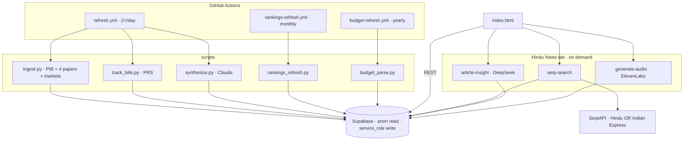
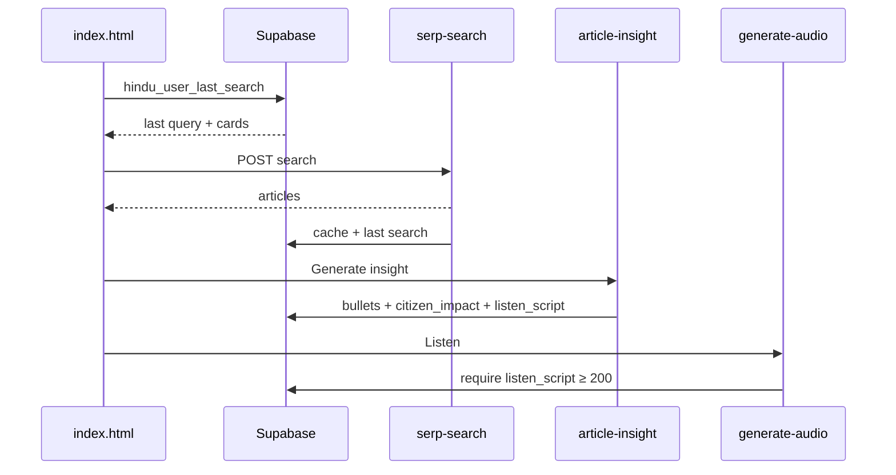

# India Monitor

**Tagline:** Facts over fog — the civic signal India can trust.

[](https://nkovaturient.github.io/India-Monitor/) [](https://nkovaturient.github.io/India-Monitor/) [](#architecture)

**One-liner:** An agentic civic-intelligence system that surfaces only what matters for education, governance, power, and people’s development — with official sources, timelines of how each story got here, and end-to-end insight so Indians speak from data, not rumour or folktale.

**Live:** [nkovaturient.github.io/India-Monitor](https://nkovaturient.github.io/India-Monitor/)

---

## Architecture



| Path | When | Writes |
|---|---|---|
| Wire, markets, stories, bills | 06:00 & 18:00 IST | `raw_items`, `stories`, `bills`, `market_snapshots`, `pipeline_health` |
| Rankings | 1st of month | `rankings_candidates` only — promote by hand |
| Budget | Manual / 2 Feb reminder | `budget_facts`, `budget_sectors` if `BUDGET_PDF_URL` is set |
| Press search | User click | Cache, quota, last search, insight, audio |

Browser uses the **anon** key. Cron and Edge Functions use **service_role**.

---

## Modules

| Module | Status | Source |
|---|---|---|
| Wire feed | Automated · 2×/day | PIB + TOI, Hindu, HT, Indian Express |
| Markets | Automated · 2×/day | Yahoo Finance |
| Story stations | Automated · grounded | Claude sees that item’s text only |
| Bills | Automated · 2×/day | PRS HTML; history append-only |
| Budget | Seeded + PDF parser | No-op until `BUDGET_PDF_URL` |
| Rankings | Candidates auto · ranks human | 18 indexes · `promote_ranking.py` |
| Constitution | Curated | Never LLM-authored |
| **Press search** | On demand · quotas | Hindu + Indian Express via Serp |

### Auto-publish rules

- Synthesis skips when the source is thin (`skip`).
- `story_stations` and `bill_status_history` are append-only.
- Stations cite `source_item_id`.
- Rank numbers never land on `rankings` without a promote step.

---

## Press search

Tab label stays **Hindu News**. Search covers **The Hindu** and **Indian Express** in one Serp call.



| Step | Behaviour |
|---|---|
| Restore | Last query + cards from `hindu_user_last_search`. No Serp, no search quota. |
| Search | `(site:thehindu.com OR site:indianexpress.com) {query}` · badge Hindu / IE · cap 12 · deduped URLs |
| Cache | 6h on `query_hash + language`. Empty results are **not** cached; empty hits are deleted and refetched. |
| Preview | Card opens a modal. Snippet is labelled preview until insight exists. |
| Insight | DeepSeek desk briefing: 5–8 anchored bullets, citizen impact, 700–900 char `listen_script`. Up to 3 peer snippets from the same result set. |
| Validation | Reject `422` if bullets, impact, or script fail thresholds. Quota increments **only** on success. |
| Listen | Disabled until `listen_script` ≥ 200 in DB. Audio uses that script only — never the Serp snippet. |
| Audio UI | Sticky bottom player: play/pause, seek, speed (0.75×–2×). Survives modal close. |
| Buzzwords | **News Buzzwords** tab: Serp + DeepSeek → `buzzwords-weekly`, 3-day cache; meta shows `week_note` + IST window. **Search press** → **Search & Listen** tab, query filled + Serp run. |

### Quotas (per browser `user_id`, 24h)

| Action | Cap | Counts when |
|---|---|---|
| Search | 3 | Fresh Serp call (cache hit does not) |
| Insight | 5 | Validation passes |
| Audio | 5 | ElevenLabs run |

Cache hits and tab restore do not spend search quota.

### Tables

| Table | Role |
|---|---|
| `hindu_articles_cache` | Serp JSON, 6h TTL |
| `quota_usage` | `search_count`, `summary_count`, `audio_count` |
| `hindu_user_last_search` | One row per user: query, language, cards |
| `hindu_article_summaries` | Bullets, `citizen_impact`, `listen_script` |
| `hindu_audio_cache` | TTS URL per article + language |
| `hindu_buzzwords_cache` | Weekly terms + `week_note`, per language, 72h TTL |

Migrations (run in order, do not replay full `schema.sql` on a live DB):

`migration_hindu_news.sql` → `migration_hindu_insight.sql` → `migration_hindu_last_search.sql` → `migration_hindu_buzzwords.sql`

### Edge functions

| Function | Secret | Model / API |
|---|---|---|
| `serp-search` | `SERP_API_KEY` | SerpAPI `engine=google`, `google.co.in` |
| `article-insight` | `DEEPSEEK_API_KEY` | `deepseek-flash` (override `DEEPSEEK_MODEL`) |
| `generate-audio` | `ELEVENLABS_API_KEY` | EN Sarah / HI multilingual |
| `buzzwords-weekly` | `SERP_API_KEY`, `DEEPSEEK_API_KEY` | Weekly buzz badges · 3-day cache |

```bash
supabase functions deploy serp-search article-insight generate-audio buzzwords-weekly
```

Setup detail: [`supabase/functions/HINDU_NEWS_SETUP.md`](supabase/functions/HINDU_NEWS_SETUP.md). Build notes: [`supabase/functions/IMPLEMENTATION_SUMMARY.md`](supabase/functions/IMPLEMENTATION_SUMMARY.md).

Wire synthesis stays on **Anthropic** inside GitHub Actions. Press insight is **DeepSeek** only.

---

## Setup

1. Supabase: base schema + seeds, then Phase 3 SQL, `seed_bill_prs_slugs.sql`, then Hindu migrations (`migration_hindu_news.sql` through `migration_hindu_buzzwords.sql`).
2. Public GitHub repo. Actions secrets: `SUPABASE_URL`, `SUPABASE_SERVICE_ROLE_KEY`, `ANTHROPIC_API_KEY`. Optional: `BUDGET_PDF_URL`.
3. Edge secrets: `SERP_API_KEY`, `DEEPSEEK_API_KEY`, `ELEVENLABS_API_KEY`. Optional: `DEEPSEEK_MODEL=deepseek-v4-pro`.
4. Pages hosts `index.html`. Frontend holds the **anon** URL + key only.
5. Dispatch **Refresh India Monitor data** once. Cron: 06:00 and 18:00 IST.

```bash
python scripts/track_bills.py --dry-run
python scripts/rankings_refresh.py --dry-run --all
python scripts/budget_parse.py --dry-run --url https://www.indiabudget.gov.in/doc/eb/vol1.pdf
python scripts/promote_ranking.py --candidate-id N
```

### Cost at this scale

| Item | Notes |
|---|---|
| Supabase | Free tier; cron keeps the project warm |
| GitHub Actions | Free on a public repo for these jobs |
| Anthropic | Wire synthesis only; skipped when ingest is empty |
| SerpAPI | 100 searches/month free; UI quota is tighter |
| DeepSeek | Paid per insight; flash by default |
| ElevenLabs | 10k chars/month free; script capped ~900 chars |

---

## Phases

| Phase | Shipped |
|---|---|
| 1 | Schema, seeds, static UI |
| 2 | PIB + markets, Claude stations, live read (no rebuild) |
| 3 | Four newspaper RSS feeds, topic allowlist, `pipeline_health`, bill provenance, rankings categories + `rankings_candidates`, wire topic tabs |
| 4 | Shared `scripts/common.py`, health strip, PRS bill tracker, monthly ranking fetchers, budget PDF parser |
| Press | Dual-outlet search, persisted last search, validated insight, listen gated on stored script |

Apply Phase 3 in order: `migration_phase3.sql`, `seed_phase3_rankings.sql`, `migration_phase3_topic.sql`.

---

## Refine next

| Item | Why |
|---|---|
| Rename tab to **Press** | UI still says Hindu News while results include Indian Express |
| Article body extract | Live blogs and thin snippets fail validation; trafilatura (or similar) in `article-insight` would ground bullets without a second Serp call |
| `DEEPSEEK_MODEL=deepseek-v4-pro` | Denser briefings when flash stays generic; higher token cost |
| Durable user id | Quota and last-search key off `sessionStorage`; a new browser resets the free tier |
| HI length checks | English uses an 80-word impact floor; Hindi should use a character or token floor, not English word count |
| Digital Sansad | PRS is enough for status; Sansad stays a manual link |
| Story review gate | Optional staging table if auto-publish gets too loose |

---

## Rankings calendar

Rankings release calendar (used by `rankings_registry.py`; publishers shift dates year to year):

| #  | Index / Report Name                  | Publishing Organization                          | Usual Release Timeline                          |
|----|--------------------------------------|--------------------------------------------------|-------------------------------------------------|
| 1  | World Air Quality Report (PM2.5)     | IQAir                                            | March (Annually)                                |
| 2  | Climate Change Performance Index     | Germanwatch / NewClimate Institute               | November / December (Annually)                  |
| 3  | Corruption Perceptions Index         | Transparency International                       | January / February (Annually)                   |
| 4  | Environmental Performance Index      | Yale / Columbia University                       | June / July (Biennially / Every 2 years)        |
| 5  | Global Firepower Index               | Global Firepower                                 | January (Annually)                              |
| 6  | GDP size (nominal)                   | IMF / World Bank                                 | April & October (Updated twice a year)          |
| 7  | Global Gender Gap Index              | World Economic Forum (WEF)                       | June / July (Annually)                          |
| 8  | Global Hunger Index                  | Concern Worldwide / Welthungerhilfe              | October (Annually)                              |
| 9  | Global Innovation Index              | WIPO (UN)                                        | September (Annually)                            |
| 10 | Gender Inequality Index              | UNDP                                             | March (Released with the HDR report)            |
| 11 | Global Peace Index                   | Institute for Economics and Peace (IEP)          | June (Annually)                                 |
| 12 | World Happiness Report               | UN Sustainable Development Solutions Network     | March 20 (International Day of Happiness)       |
| 13 | Human Development Index              | UNDP                                             | March / December (Every 1 to 2 years)           |
| 14 | Logistics Performance Index          | World Bank                                       | Variable (Every 2 to 3 years)                   |
| 15 | Henley Passport Index                | Henley & Partners                                | Monthly / Quarterly (Continuous updates)        |
| 16 | World Press Freedom Index            | Reporters Without Borders (RSF)                  | May 3 (World Press Freedom Day)                 |
| 17 | Rule of Law Index                    | World Justice Project (WJP)                      | October (Annually)                              |
| 18 | Global Soft Power Index              | Brand Finance                                    | February / March (Annually)                     |
